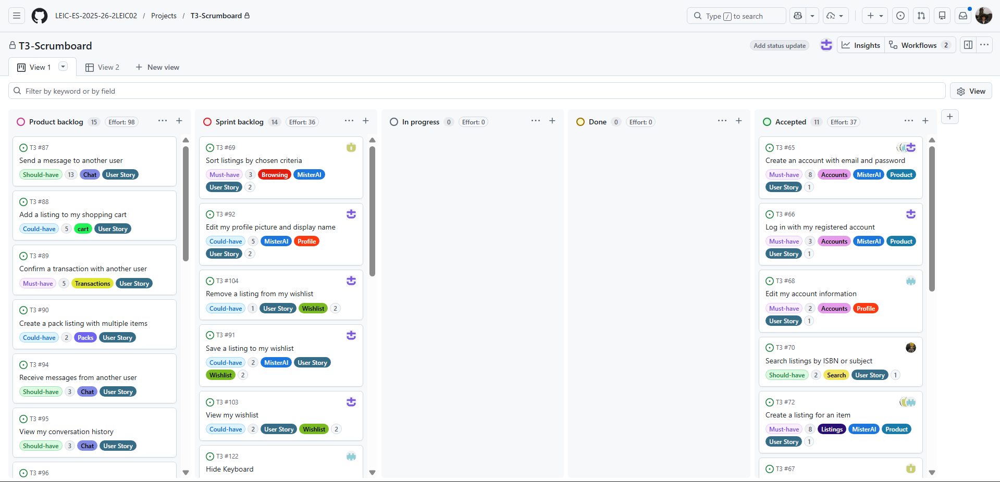
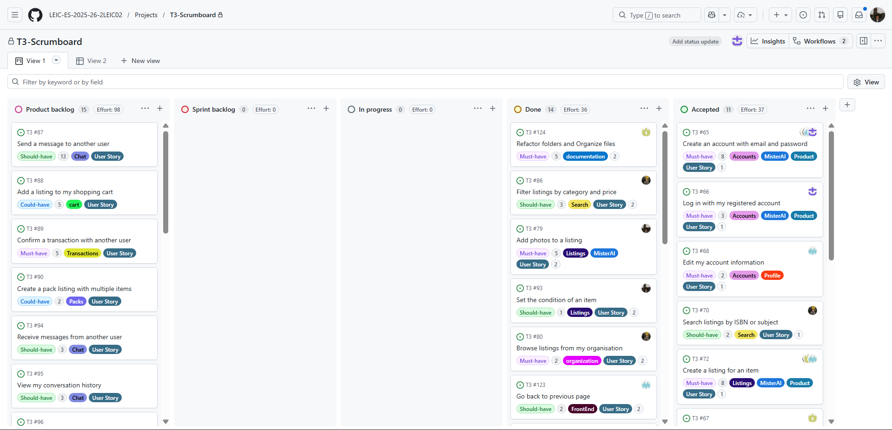
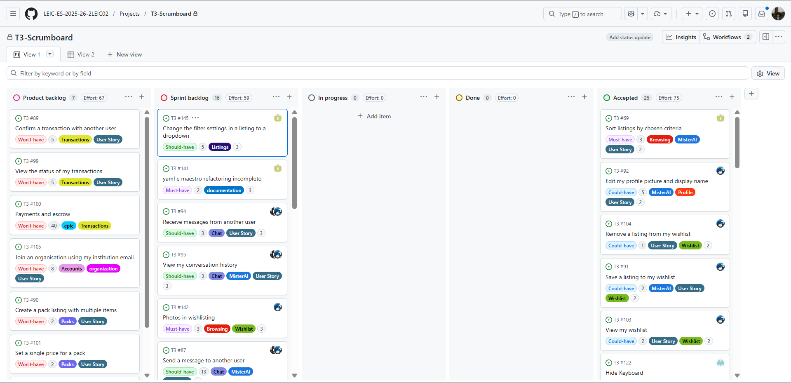
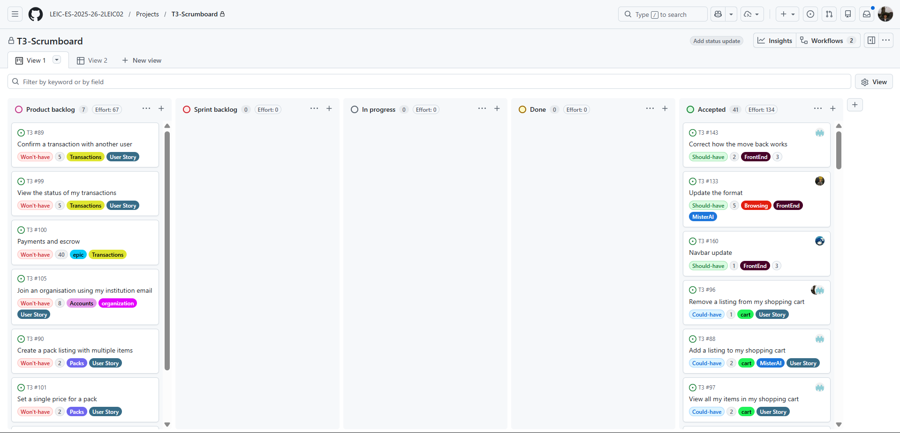

# EduCycle — Development Report

Welcome to the documentation of **EduCycle**!

This Software Development Report, tailored for **LEIC-ES-2025-26 (Group T3)**, covers the full lifecycle of EduCycle — from high-level product vision down to low-level implementation decisions, sprint management, and architecture.

It is organised by the following activities:

- [Team](#team)
- [Business Modelling](#business-modelling)
  - [Product Vision](#product-vision)
  - [Features and Assumptions](#features-and-assumptions)
- [Requirements](#requirements)
  - [User Stories](#user-stories)
  - [Domain Model](#domain-model)
  - [User Interfaces](#user-interfaces)
- [Architecture and Design](#architecture-and-design)
  - [Logical Architecture](#logical-architecture)
  - [Physical Architecture](#physical-architecture)
  - [Functional Prototype](#functional-prototype)
- [Project Management](#project-management)
  - [Sprint 0](#sprint-0)
  - [Sprint 1](#sprint-1)
  - [Sprint 2](#sprint-2)
  - [Sprint 3](#sprint-3)
  - [Final Release](#final-release)

---

## Team

| Name             | Email             |
| ---------------- | ----------------- |
| Afonso Cabral    | up202405418@up.pt |
| Artur Ferro      | up202404762@up.pt |
| Guilherme Nunes  | up202404656@up.pt |
| Henrique Pereira | up202404170@up.pt |
| João Leppanen    | up200202572@up.pt |

> Contributions are expected to be made exclusively by the initial team. After the course ends, we may open contributions to the community across all areas: requirements, technologies, development, experimentation, testing, etc.
>
> **Please contact us if you'd like to get involved!**

---

## Business Modelling

### Product Vision

> _"To make access to school supplies fairer, more affordable, and sustainable for all students."_

**For students, families and educators who need affordable school and academic materials. EduCycle is a peer-to-peer marketplace that allows users to buy, sell, trade and lend used educational items. Unlike general second-hand platforms, EduCycle is built exclusively for the academic journey, organised by school level, discipline and institution.**

---

### Features and Assumptions

#### Features

- **Feature SELL** — List any used school or academic item for sale, individually or as a pack, with photos, condition rating and price.
- **Feature TRADE** — Propose a direct item-for-item trade with another user, without any monetary exchange.
- **Feature LEND** — Make an item available for a defined loan period, so other students can use it temporarily.
- **Feature SCHOOL LEVELS** — Browse and filter all listings by education level: Escola Básica (1st–9th), Escola Secundária (10th–12th), or Faculdade / Ensino Superior.
- **Feature ORGANISATIONS** — Create or join private community spaces tied to a specific school or institution, accessible via invite code.
- **Feature CHAT** — Send direct messages between buyer and seller to negotiate, clarify details or arrange delivery.
- **Feature WISHLIST** — Save desired items and receive automatic alerts when a matching listing becomes available.
- **Feature PACKS & DISCOUNTS** — Group multiple items into a single listing with a bundled price, or apply percentage discounts to individual listings.
- **Feature FILTERS & SEARCH** — Search by title, ISBN, author or subject; filter by level, year, subject, condition, price range, location and transaction mode.
- **Feature PAYMENTS & ESCROW** — Secure integrated payments (card, MB Way, Multibanco reference) held in escrow until delivery is confirmed.
- **Feature RATINGS & REVIEWS** — Rate and review the other party after each completed transaction to build trust in the community.
- **Feature SUPPORT CHAT** — Contact the EduCycle support team directly from within the app.
- **Feature SHIPPING** — Generate pre-paid shipping labels and track deliveries natively in the app.

#### Assumptions

- Users are assumed to have a smartphone or web browser and a valid email address to register.
- Payment processing depends on integration with a third-party payment provider (e.g. Stripe or similar).
- Shipping label generation depends on integration with carrier APIs (e.g. CTT, DPD).
- Organisation administrators are responsible for managing their own community spaces; EduCycle provides the tooling.
- The platform assumes good faith from its users, supported by the escrow system, ratings and moderation tools.

---

## Requirements

### User Stories

Below is a concise summary of all user stories for EduCycle, grouped by area. Each user story is created and tracked as an item in the GitHub Project with the label **"user story"**.

---

- **User Registration (Account)**

  > **As a** student, **I want to** create an account using my email, **so that** I can have a verified identity on the platform.

- **Publishing a Listing (Issuing)**

  > **As a** seller, **I want to** create a listing with a photo, title, and price, **so that** I can put my school materials up for sale or swap.

- **Browsing Materials (Discovery)**

  > **As a** buyer, **I want to** browse a feed of recently added items, **so that** I can discover school materials I might need.

- **Advanced Search & Filters (Discovery)**

  > **As a** buyer, **I want to** search for specific keywords and filter by academic year, **so that** I can quickly find the exact study materials I need.

- **Chat & Negotiation (Transactions)**
  > **As a** user, **I want to** send direct messages to other users, **so that** I can easily negotiate prices and arrange safe deliveries.

---

### Domain Model

  

---

### User Interfaces

_User interface mockups — see [Architecture and Design > User Interface Mockups](#user-interface-mockups) below._

---

## Architecture and Design

### Logical Architecture

  

---

### Physical Architecture

  

**Technology choices:**

- **Frontend:** Flutter (cross-platform mobile and web)
- **Backend:** Node.js / Firebase Functions
- **Database:** Firebase Firestore
- **Authentication:** Firebase Auth
- **Payments:** Stripe or similar
- **Notifications:** Firebase Cloud Messaging (FCM)
- **Shipping:** CTT / DPD API integration

---

### User Interface Mockups

UI mockups designed for each key screen of the EduCycle application:

#### Welcome & Authentication

  
  &nbsp;&nbsp;
  
  &nbsp;&nbsp;
  

#### Browsing & Discovery

  
  &nbsp;&nbsp;
  

#### Listings & Shopping

  
  &nbsp;&nbsp;
  

#### Community & Chat

  
  &nbsp;&nbsp;
  

#### Profile

  
  &nbsp;&nbsp;
  

---

### Functional Prototype

_Functional prototype to be added after the initial implementation sprint._

---

## Project Management

- Backlog management: Product backlog and Sprint backlog in a [GitHub Projects board](#)
- Release management: v0, v1, v2, v3, …
- Sprint planning and retrospectives:
  - **Plans:** screenshots of GitHub Projects board at beginning and end of each Sprint
  - **Retrospectives:** meeting notes addressing — _Did well_, _Do differently_, _Puzzles_, _Improvements for the next Sprint_

---

### Sprint 0

#### Scrum Board

  

#### Product Backlog Prioritization (User Survey)

A user survey (12 responses) to validate and prioritize Sprint 1 requirements.

- [View Full Survey Results and Backlog Order](docs/report_survey_results.md)
- [Download Raw Survey Data (CSV)](docs/survey_results.csv)
- [Link to Google Form](https://forms.gle/iXGvBxd6eWcE436r8)

#### Retrospective

**What went well**
The team successfully set up the project repository, aligned on the product vision, and produced a first draft of the backlog with core user stories. Communication and task distribution were smooth throughout the sprint.

**What to do differently**
User stories should be drafted and refined earlier in the sprint to leave room for discussion before the deadline.

**Open questions**
The expected scope of the functional prototype for Sprint 1 still needs clarification from the teaching staff.

**Improvements for next sprint**

- Discuss requirements and design decisions earlier in the sprint to avoid last-minute blockers
- Set up a shared document for meeting notes so decisions are not lost after calls
- Review each other's pull requests within 24 hours to avoid merge delays

---

### Sprint 1

#### Scrum Board

  

  

#### Sprint 0 Review — Feedback Addressed

During the Sprint 0 Review, the teaching staff identified the following issues that the team committed to addressing in Sprint 1:

| #   | Feedback Received                                | Action Taken                                                                                                                                                 |
| --- | ------------------------------------------------ | ------------------------------------------------------------------------------------------------------------------------------------------------------------ |
| 1   | **PBIs must be in the PBL, not in the README**   | All PBIs were moved to the GitHub Projects board and removed from the README.                                                                                |
| 2   | **Missing names in associations (Domain Model)** | Role names and multiplicity labels were added to all associations in the Domain Model diagram.                                                               |
| 3   | **Missing text in the Architecture section**     | Descriptive text explaining the rationale and responsibilities of each layer was added to the Logical and Physical Architecture sections.                    |
| 4   | **PBIs must be well specified**                  | Each PBI was rewritten with clear, testable acceptance criteria (Given/When/Then format) and linked to the corresponding feature branch and pull request.    |
| 5   | **Not sure about the CI pipeline**               | The pipeline was stabilised: a merge-blocking error was fixed, flaky timeout tests were removed, and the full unit-test suite was merged into `development`. |

#### Sprint Retrospective

**What went well**
All six planned PBIs were delivered and merged into development before the review deadline. Firebase Authentication and profile management were successfully integrated end-to-end. The CI pipeline was stabilised, unblocking the team from merge conflicts that plagued Sprint 0. Test coverage improved across authentication and profile flows.

Retrospective includes suggestions for improvement and a strategy including verifiable action points:

| Suggestion for Improvement | Strategy / Action Point | Verifiable Outcome |
|---|---|---|
| **Sprint tags on issues** | Add sprint tags to each issue in GitHub. | All open issues carry exactly one sprint label. |
| **Back button not working** | The back button does not function; fix the navigation routing. | Back button is fixed and an automated navigation test passes. |
| **Automation, pipeline & tests** | Set up GitHub automation for app deployment and metrics, improve testing, document bugs/fixes, and enhance the pipeline. | Deploy jobs run on Actions; tests are improved, and PRs document metrics/fixes. |

---

### Sprint 2

#### Scrum Board

  

  

#### Sprint 1 Review — Feedback Addressed

During the Sprint 1 Review, the teaching staff and team identified the following issues that were committed to and addressed during Sprint 2:

| # | Feedback Received | Action Taken |
|---|---|---|
| 1 | **Sprint tags missing on issues** | `sprint-1` and `sprint-2` labels were created and applied to all relevant issues. Tagging is now mandatory as part of the Definition of Ready. |
| 2 | **Back button does not work** | All stack screens were audited. Swipe-right back navigation was implemented (`feat/swipeBack`, PR #129). |
| 3 | **No GitHub automation for deployment and metrics** | A two-phase CI/CD pipeline was configured: Phase 1 runs lint + test coverage on every PR; Phase 2 triggers an EAS Android APK build on every merge to `main` (`feature/deployment-pipeline`, PR #126). |

#### Sprint Retrospective

**What went well**
The listing discovery experience was significantly expanded and delivered on time. Multi-photo uploads, mandatory condition validation, and ISBN tagging were successfully delivered. Feed sorting, wishlist saving functionalities, and a native swipe-right navigation were securely integrated, greatly improving the fluidity of the user experience.

Retrospective includes suggestions for improvement and a strategy including verifiable action points:

| Suggestion for Improvement | Strategy / Action Point | Verifiable Outcome |
|---|---|---|
| **Wishlist photos missing** | The wishlist does not fetch listing photos (Update queries to fetch images). | Wishlist screen successfully displays the correct listing images. |
| **Top bar height incorrect** | The header bar on a listing needs to be moved lower (Add appropriate padding/margin). | Listing header aligns perfectly with other screens in the app. |
| **Back button route wrong** | The "back" button doesn't return to the last tab, but goes to the homepage instead (Fix navigation stack). | Back button correctly restores the previously active tab or screen. |
| **PR Reviews needed** | Pull requests must be approved by someone other than the author (Require reviewers). | Branch protection rules block merges without at least 1 approval. |
| **Test Commits** | Keep up the practice: every push must include a commit containing tests for that feature. | All feature PRs include corresponding unit/e2e tests in their commits. |
| **UI Responsiveness & Consistency**| Make the UI more responsive and consistent (Audit components and layout). | Screens adapt fluidly and use uniform dimensions, spacing, and styles. |
| **Subject Selection Dropdown** | Change the subject selection in a listing to a searchable dropdown menu. | The 'Subject' field in New Listing is a searchable dropdown component. |

---

### Sprint 3

#### Scrum Board

  

  

#### Sprint 2 Review — Feedback Addressed

During the Sprint 2 Review, the teaching staff and team identified the following issues that were committed to and addressed during Sprint 3:

| # | Feedback Received | Action Taken |
|---|---|---|
| 1 | **Wishlist photos missing** | Updated queries to ensure wishlist properly fetches and renders listing images. |
| 2 | **Top bar height incorrect** | Applied global `SafeAreaProvider` and fixed safe area insets to align top and bottom bars properly (`1c0c266`, `fd56245`). |
| 3 | **Back button route wrong** | Fixed swipe-back navigation and routing behavior (`7fb47e9`). |
| 4 | **UI Responsiveness & Consistency** | Complete UI overhaul replacing emojis with `Ionicons` and fixing the Navbar so it is no longer hidden behind phone OS functions (`92af3df`, `5943a6f`). |
| 5 | **Subject Selection Dropdown** | Replaced the free-text subject field in new listings with a standardized Dropdown selector (`cb019ac`). |

#### Sprint Retrospective

**What went well**
The team successfully implemented major UI/UX improvements, most notably the full Dark Mode system and replacing temporary text/emojis with a professional `Ionicons` set. The Shopping Cart and Request Purchase flows were completed on time, adding significant business value. We also resolved persistent UI padding issues with the Navbar and Safe Area views across different screen sizes.

**Areas for Improvement & Action Plan**

| Suggestion for Improvement | Strategy / Action Point | Verifiable Outcome |
|---|---|---|
| **Test Coverage Script Stability** | Jest was hanging or hiding open handles with `--forceExit`. | Swapped to `--detectOpenHandles` and fixed test leaks. Tests close cleanly. |
| **Pipeline Reliability** | EAS builds failed due to Node version deprecation. | Pinned the pipeline to Node.js 20. Future-proof action configurations. |
| **Chat Component Robustness** | Photos in chat had rendering issues. | Image rendering in chat was patched, but requires further testing for different aspect ratios. |

---
---

### Final Release

_Final release notes and retrospective to be added._
